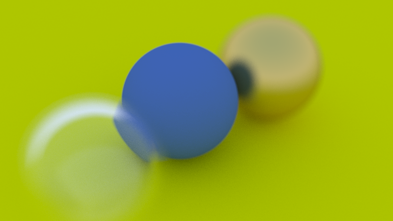

# Ray Tracer

A ray tracer written from scratch in C++17, following Peter Shirley's
[*Ray Tracing in One Weekend*](https://raytracing.github.io/) series.



## Features

- 3D vector math library with operator overloading (`vector3`)
- PPM image output with gamma correction, converted to PNG
- Ray-sphere intersection using the simplified quadratic formula
- Multiple objects through an abstract `hittable` class and `hittable_list`
- Antialiasing by averaging jittered samples per pixel
- Recursive ray bouncing with a configurable depth limit
- Materials:
  - Lambertian (diffuse)
  - Metal with adjustable fuzz
  - Dielectric (glass) with refraction, total internal reflection and
    Schlick reflectance
- Positionable camera (`lookfrom`, `lookat`, `vup`, adjustable field of view)
- Defocus blur (depth of field) via a thin-lens model

## Building and running

Requirements: `g++` (C++17), `make`, and ImageMagick (for PNG conversion).

```bash
sudo apt install build-essential imagemagick
```

From the project root:

```bash
make view    # build, render, convert to PNG and open it
make run     # build and render only
make test    # build and run src/test.cpp
make clean   # remove build output
```

The renderer writes a PPM image to `build/image.ppm`, which is converted to a
timestamped PNG in `renders/` (`renders/render_YYYYMMDD_HHMMSS.png`).

Scene and camera settings are configured in `src/main.cpp`. Render time
scales with `image_width`, `samples_per_pixel` and `max_depth`; lower these
for quick previews.

## Project structure

```
raytracer/
├── src/
│   ├── common.h         # shared constants, random numbers, common includes
│   ├── vec3.h           # vector3 class, point3 alias, vector math and sampling
│   ├── color.h          # color alias, gamma correction and pixel output
│   ├── ray.h            # ray: origin + t * direction
│   ├── interval.h       # [min, max] ranges for hit tests and clamping
│   ├── hittable.h       # hit_record and the abstract hittable class
│   ├── hittable_list.h  # a list of hittables treated as one object
│   ├── sphere.h         # ray-sphere intersection
│   ├── material.h       # lambertian, metal and dielectric materials
│   ├── camera.h         # camera setup, ray generation and the render loop
│   ├── main.cpp         # scene setup
│   └── test.cpp         # debug output for the intersection math
├── docs/
│   └── API_REFERENCE.md # every type and function, file by file
├── renders/             # saved output images
├── build/               # compiled binaries and temporary images (git-ignored)
└── Makefile
```

## Documentation

- [docs/API_REFERENCE.md](docs/API_REFERENCE.md) lists every class, function
  and constant per source file along with its purpose.
- Each function in `src/` has a block comment explaining what it does and
  the reasoning or math behind it.

## Roadmap

1. ~~*Ray Tracing in One Weekend*~~ (complete)
2. Multithreading with `std::thread`, with benchmarks against the
   single-threaded version
3. *Ray Tracing: The Next Week* (BVH acceleration, textures, lights)
4. CUDA port, with CPU vs GPU benchmarks
5. *Ray Tracing: The Rest of Your Life* (Monte Carlo and importance sampling)

## Acknowledgments

Based on the [*Ray Tracing in One Weekend*](https://raytracing.github.io/)
book series by Peter Shirley, Trevor David Black and Steve Hollasch.
