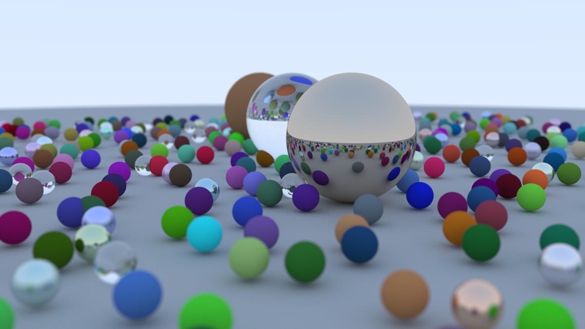

# Ray Tracer (CPU multithreaded)

A ray tracer written from scratch in C++17, following Peter Shirley's
[*Ray Tracing in One Weekend*](https://raytracing.github.io/) series.

This is the `cpu-multithreading` branch: the book 1 renderer, parallelized
across all CPU cores with `std::thread`. The single-threaded version that
follows the book directly lives on [`main`](https://github.com/Harsha685/Ray_Tracer/tree/main).



## Features

- 3D vector math library with operator overloading (`vector3`)
- PPM image output with gamma correction, converted to PNG
- Ray-sphere intersection using the simplified quadratic formula
- Multiple objects through an abstract `hittable` class and `hittable_list`
- Antialiasing by averaging jittered samples per pixel
- Recursive ray bouncing with a configurable depth limit
- Materials:
  - Lambertian (diffuse)
  - Metal with adjustable fuzz
  - Dielectric (glass) with refraction, total internal reflection and
    Schlick reflectance
- Positionable camera (`lookfrom`, `lookat`, `vup`, adjustable field of view)
- Defocus blur (depth of field) via a thin-lens model
- Multithreaded rendering with `std::thread`: rows are handed out through an
  atomic counter, and each thread has its own random number generator

## Multithreading

Every pixel is computed independently, so rendering parallelizes well. The
changes from the single-threaded version are all in `camera::render()` and
`random_double()`:

- **Frame buffer.** Pixels are written into a pre-sized `std::vector<color>`
  (pixel `(i, j)` at index `i * image_width + j`) instead of straight to
  stdout. Each thread writes only its own slots, so no locking is needed, and
  the image is written in order once every thread has finished.
- **Dynamic row scheduling.** Threads claim rows one at a time from a shared
  `std::atomic<int>` counter. Rows cost very different amounts (glass and
  metal bounce a lot, sky returns immediately), so threads that finish early
  just claim more rows instead of sitting idle.
- **Per-thread random number generators.** A single shared `std::mt19937`
  would be a data race, because every call updates its state. Each thread has
  its own `thread_local` generator. Seeds come from an atomic counter: the
  main thread always gets seed 0, so the randomly generated scene is identical
  on every run, and each render thread gets a different seed.
- **No shared reference counts in the hot path.** `hit_record` holds a plain
  `material*` instead of a `shared_ptr<material>`. Copying a `shared_ptr`
  updates an atomic reference count, and with every thread updating the same
  few counters on every ray hit, the threaded version was no faster than the
  single-threaded one. Removing it gave the speedup below.

The code was checked for data races with ThreadSanitizer
(`-fsanitize=thread`).

## Benchmarks

Book 1 final scene (about 485 spheres), 1200×675, 500 samples per pixel,
max depth 100. Intel Core i7-13650HX (6 performance + 8 efficiency cores,
20 hardware threads), `g++ -O3 -march=native`, measured with
`hyperfine --runs 3`.

| Threads | Time | Speedup |
|--------:|-----:|--------:|
| 1  | 841.2 s ± 3.6 s (14 min 1 s) | 1.00× |
| 20 | 126.5 s ± 2.0 s (2 min 7 s)  | 6.65× |

The speedup is below 20× for three reasons:

- 12 of the 20 hardware threads are hyper-threads sharing 6 performance
  cores, and a pair of threads does far less than twice the work of one.
- 8 threads run on the slower efficiency cores.
- A sustained all-core load makes the laptop lower its clock speeds to stay
  within its power and temperature limits, while a single thread runs at
  full boost clock.

All 20 threads stay busy for the whole render (CPU time ÷ wall time ≈ 19.4),
so the remaining gap comes from the hardware, not from the threading.

## Building and running

Requirements: `g++` (C++17), `make`, and ImageMagick (for PNG conversion).

```bash
sudo apt install build-essential imagemagick
```

From the project root:

```bash
make view    # build, render, convert to PNG and open it
make run     # build and render only
make test    # build and run src/test.cpp
make clean   # remove build output
```

The renderer writes a PPM image to `build/image.ppm`, which is converted to a
timestamped PNG in `renders/` (`renders/render_YYYYMMDD_HHMMSS.png`).

Scene and camera settings are configured in `src/main.cpp`. Render time
scales with `image_width`, `samples_per_pixel` and `max_depth`; lower these
for quick previews. `thread_count` sets the number of render threads (0 uses
one per logical CPU core).

To benchmark, build first and time only the renderer:

```bash
make && hyperfine --runs 3 './build/raytracer'
```

## Project structure

```
raytracer/
├── src/
│   ├── common.h         # shared constants, per-thread random numbers, common includes
│   ├── vec3.h           # vector3 class, point3 alias, vector math and sampling
│   ├── color.h          # color alias, gamma correction and pixel output
│   ├── ray.h            # ray: origin + t * direction
│   ├── interval.h       # [min, max] ranges for hit tests and clamping
│   ├── hittable.h       # hit_record and the abstract hittable class
│   ├── hittable_list.h  # a list of hittables treated as one object
│   ├── sphere.h         # ray-sphere intersection
│   ├── material.h       # lambertian, metal and dielectric materials
│   ├── camera.h         # camera setup, ray generation and the multithreaded render loop
│   ├── main.cpp         # scene setup (book 1 final scene)
│   └── test.cpp         # debug output for the intersection math
├── docs/
│   └── API_REFERENCE.md # every type and function, file by file
├── renders/             # saved output images
├── build/               # compiled binaries and temporary images (git-ignored)
└── Makefile
```

## Documentation

- [docs/API_REFERENCE.md](docs/API_REFERENCE.md) lists every class, function
  and constant per source file along with its purpose.
- Each function in `src/` has a block comment explaining what it does and
  the reasoning or math behind it.

## Roadmap

1. ~~*Ray Tracing in One Weekend*~~ (complete)
2. ~~Multithreading with `std::thread`, with benchmarks against the
   single-threaded version~~ (complete, this branch)
3. *Ray Tracing: The Next Week* (BVH acceleration, textures, lights), then
   bring this branch's multithreading up to it
4. CUDA port, with CPU vs GPU benchmarks
5. *Ray Tracing: The Rest of Your Life* (Monte Carlo and importance sampling)

## Acknowledgments

Based on the [*Ray Tracing in One Weekend*](https://raytracing.github.io/)
book series by Peter Shirley, Trevor David Black and Steve Hollasch.
