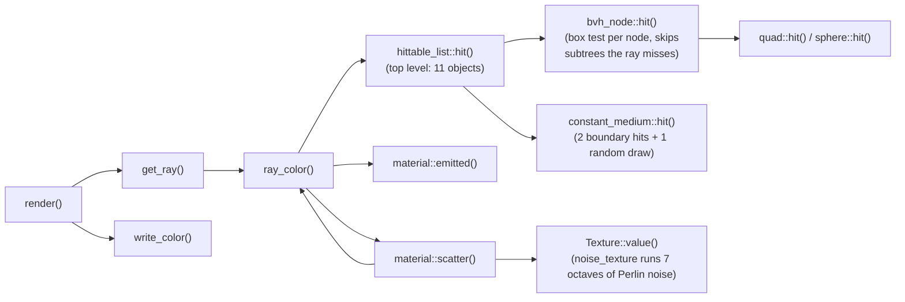

# Call Graph

What each function calls, starting from `main()` (which builds the book 2 final
scene). Vector operators (`+`, `-`, `*`, `/`), trivial getters (`x()`, `origin()`,
`time()`, `bounding_box()` of a stored box, ...) and `aabb` / `interval`
constructors used only to combine boxes are left out to keep it readable.

- Solid arrows: direct calls.
- Dotted arrows: virtual dispatch (the actual function depends on the object's type).
- The `ray_color` self-loop is the bounce recursion, limited by `max_depth`.
- The `bvh_node::hit` self-loop is the tree descent.

```mermaid
flowchart TD
    main["main()"] --> final_scene["final_scene()"]

    subgraph scene["Scene setup (main.cpp)"]
        add["hittable_list::add()"]
        box_fn["box()"]
        quad_ctor["quad() constructor"]
        sphere_ctor["sphere() constructors<br/>(static and moving)"]
        bvh_ctor["bvh_node() constructors"]
        medium_ctor["constant_medium()"]
        inst_ctors["rotate_y() / translate()"]
        mat_ctors["lambertian() / metal() / dielectric() / diffuse_light()"]
        tex_ctors["noise_texture() / image_texture()"]
    end

    subgraph build["Construction helpers"]
        solid_ctor["Solid_color()"]
        iso_ctor["isotropic()"]
        quad_bbox["quad::set_bounding_box()"]
        aabb_pts["aabb(point3, point3)"]
        pad["aabb::pad_to_minimums()"]
        box_cmp["bvh_node::box_x/y/z_compare()<br/>(via std::sort)"]
        perlin_ctor["perlin()"]
        gen_perm["perlin::perlin_generate_perm()"]
        permute["perlin::permute()"]
        img_ctor["image_loader(filename)"]
        img_load["image_loader::load()"]
        stbi["stbi_loadf()"]
        to_bytes["image_loader::convert_to_bytes()"]
    end

    subgraph cam["camera.h"]
        render["camera::render()"]
        initialize["camera::initialize()"]
        get_ray["camera::get_ray()"]
        sample_square["camera::sample_square()"]
        ray_color["camera::ray_color()"]
    end

    subgraph hit["Intersection"]
        list_hit["hittable_list::hit()"]
        bvh_hit["bvh_node::hit()"]
        aabb_hit["aabb::hit_interval()"]
        trans_hit["translate::hit()"]
        rot_hit["rotate_y::hit()"]
        medium_hit["constant_medium::hit()"]
        sphere_hit["sphere::hit()"]
        sphere_uv["sphere::get_sphere_uv()"]
        quad_hit["quad::hit()"]
        interior["quad::is_interior()"]
        face_normal["hit_record::set_face_normal()"]
    end

    subgraph mat["material.h"]
        emitted_default["material::emitted()<br/>(black)"]
        light_emit["diffuse_light::emitted()"]
        lam["lambertian::scatter()"]
        met["metal::scatter()"]
        die["dielectric::scatter()"]
        iso["isotropic::scatter()"]
        absorb["material::scatter()<br/>(diffuse_light: absorbs)"]
        reflectance["dielectric::reflectance()"]
    end

    subgraph tex["texture.h / perlin.h / image_loader.h"]
        solid_val["Solid_color::value()"]
        noise_val["noise_texture::value()"]
        image_val["image_texture::value()"]
        turb["perlin::turb()"]
        noise["perlin::noise()"]
        interp["perlin::perlin_interp()"]
        pixel_data["image_loader::pixel_data()"]
    end

    subgraph out["color.h"]
        write_color["write_color()"]
        gamma["linear_to_gamma()"]
    end

    subgraph util["vec3.h / common.h helpers"]
        unit_vector["unit_vector()"]
        cross["cross()"]
        dot["dot()"]
        rand_unit["random_unit_vector()"]
        vec_random["vector3::random(min, max)"]
        reflect["reflect()"]
        refract["refract()"]
        deg2rad["degrees_to_radians()"]
        rand_d["random_double()"]
        rand_int["random_int()"]
    end

    %% scene construction
    final_scene --> box_fn
    final_scene --> bvh_ctor
    final_scene --> quad_ctor
    final_scene --> sphere_ctor
    final_scene --> medium_ctor
    final_scene --> inst_ctors
    final_scene --> mat_ctors
    final_scene --> tex_ctors
    final_scene --> add
    final_scene -- "box heights" --> rand_d
    final_scene -- "sphere cluster" --> vec_random
    final_scene --> render

    box_fn --> quad_ctor
    box_fn --> add
    quad_ctor --> cross
    quad_ctor --> unit_vector
    quad_ctor --> quad_bbox
    quad_bbox --> aabb_pts
    sphere_ctor --> aabb_pts
    aabb_pts --> pad
    bvh_ctor --> rand_int
    bvh_ctor --> box_cmp
    bvh_ctor -- "recursion" --> bvh_ctor
    inst_ctors --> deg2rad
    inst_ctors --> aabb_pts
    medium_ctor --> iso_ctor
    iso_ctor --> solid_ctor
    mat_ctors -- "color overloads" --> solid_ctor

    tex_ctors -- "noise_texture" --> perlin_ctor
    tex_ctors -- "image_texture" --> img_ctor
    perlin_ctor --> vec_random
    perlin_ctor --> unit_vector
    perlin_ctor --> gen_perm
    gen_perm --> permute
    permute --> rand_int
    img_ctor --> img_load
    img_load --> stbi
    img_load --> to_bytes

    %% camera
    render --> initialize
    render --> get_ray
    render --> ray_color
    render --> write_color
    initialize --> deg2rad
    initialize --> unit_vector
    initialize --> cross
    get_ray --> sample_square
    get_ray -- "ray time" --> rand_d
    sample_square --> rand_d

    ray_color -. "world.hit()" .-> list_hit
    ray_color -. "rec.mat->emitted()" .-> emitted_default
    ray_color -. "rec.mat->emitted()" .-> light_emit
    ray_color -. "rec.mat->scatter()" .-> lam
    ray_color -. "rec.mat->scatter()" .-> met
    ray_color -. "rec.mat->scatter()" .-> die
    ray_color -. "rec.mat->scatter()" .-> iso
    ray_color -. "rec.mat->scatter()" .-> absorb
    ray_color -- "depth - 1" --> ray_color

    %% intersection
    list_hit -. "object->hit()" .-> bvh_hit
    list_hit -. "object->hit()" .-> quad_hit
    list_hit -. "object->hit()" .-> sphere_hit
    list_hit -. "object->hit()" .-> medium_hit
    list_hit -. "object->hit()" .-> trans_hit

    bvh_hit --> aabb_hit
    bvh_hit -. "child->hit()" .-> bvh_hit
    bvh_hit -. "child->hit() (a box's quads)" .-> list_hit
    bvh_hit -. "child->hit()" .-> sphere_hit

    trans_hit -. "object->hit()" .-> rot_hit
    rot_hit -. "object->hit()" .-> bvh_hit

    medium_hit -. "boundary->hit() twice" .-> sphere_hit
    medium_hit -- "scatter distance" --> rand_d

    sphere_hit --> dot
    sphere_hit --> face_normal
    sphere_hit --> sphere_uv
    quad_hit --> dot
    quad_hit --> cross
    quad_hit --> interior
    quad_hit --> face_normal
    face_normal --> dot

    %% materials
    light_emit -. "tex->value()" .-> solid_val
    lam --> rand_unit
    lam -. "tex->value()" .-> solid_val
    lam -. "tex->value()" .-> noise_val
    lam -. "tex->value()" .-> image_val
    met --> reflect
    met --> unit_vector
    met --> rand_unit
    die --> unit_vector
    die --> reflectance
    die --> rand_d
    die --> reflect
    die --> refract
    iso --> rand_unit
    iso -. "tex->value()" .-> solid_val

    %% textures
    noise_val --> turb
    turb --> noise
    noise --> interp
    interp --> dot
    image_val --> pixel_data

    %% output
    write_color --> gamma

    %% helpers calling helpers
    reflect --> dot
    refract --> dot
    rand_unit --> vec_random
    vec_random --> rand_d
    rand_int --> rand_d
```

## Hot path

Per pixel sample, the work that actually dominates render time:

The scene-wide mist is a `constant_medium` around a 5000-radius sphere, so every
ray pays for its two boundary hits, whatever else it hits.

## Not reached from the current `main()`

These exist but the book 2 final scene never calls them:

- `checker_texture`, `Solid_color(r, g, b)`, and the texture overloads of
  `diffuse_light`, `isotropic` and `constant_medium`.
- `camera::defocus_disk_sample()` and `random_in_unit_disk()` (the scene sets
  `defocus_angle = 0`), and the sky gradient in `ray_color()` (`use_sky = false`).
- `image_loader()` (default constructor), `random_on_hemisphere()`, `vector3::random()` (no-argument),
  `hittable_list(obj)` constructor, `hittable_list::clear()`, `interval::empty`,
  and the `operator+(double, interval)` / `operator+(vector3, aabb)` overloads.
