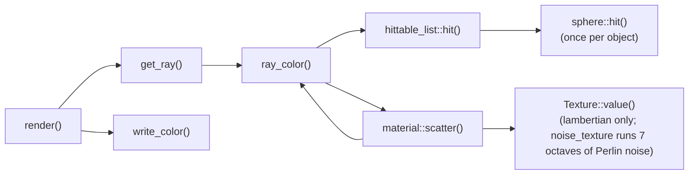

# Call Graph

What each function calls, starting from `main()`. Vector operators (`+`, `-`, `*`, `/`)
and trivial getters (`x()`, `origin()`, `time()`, ...) are left out to keep it readable.

- Solid arrows: direct calls.
- Dotted arrows: virtual dispatch (the actual function depends on the object's type).
- The `ray_color` self-loop is the bounce recursion, limited by `max_depth`.

```mermaid
flowchart TD
    main["main()"]

    subgraph scene["Scene setup (main.cpp)"]
        add["hittable_list::add()"]
        sphere_ctor["sphere() constructor"]
        mat_ctors["lambertian() / metal() / dielectric()"]
        tex_ctors["noise_texture() / image_texture()"]
    end

    subgraph build["Construction helpers"]
        solid_ctor["Solid_color()"]
        aabb_pts["aabb(point3, point3)"]
        aabb_boxes["aabb(aabb, aabb)"]
        interval_join["interval(interval, interval)"]
        sphere_bbox["sphere::bounding_box()"]
        perlin_ctor["perlin()"]
        gen_perm["perlin::perlin_generate_perm()"]
        permute["perlin::permute()"]
        img_ctor["image_loader(filename)"]
        img_load["image_loader::load()"]
        stbi["stbi_loadf()"]
        to_bytes["image_loader::convert_to_bytes()"]
        f2b["image_loader::float_to_byte()"]
    end

    subgraph cam["camera.h"]
        render["camera::render()"]
        initialize["camera::initialize()"]
        get_ray["camera::get_ray()"]
        sample_square["camera::sample_square()"]
        defocus["camera::defocus_disk_sample()"]
        ray_color["camera::ray_color()"]
    end

    subgraph hit["Intersection"]
        list_hit["hittable_list::hit()"]
        sphere_hit["sphere::hit()"]
        sphere_uv["sphere::get_sphere_uv()"]
        surrounds["interval::surrounds()"]
        ray_at["ray::at()"]
        face_normal["hit_record::set_face_normal()"]
    end

    subgraph mat["material.h"]
        lam["lambertian::scatter()"]
        met["metal::scatter()"]
        die["dielectric::scatter()"]
        reflectance["dielectric::reflectance()"]
    end

    subgraph tex["texture.h / perlin.h / image_loader.h"]
        solid_val["Solid_color::value()"]
        noise_val["noise_texture::value()"]
        image_val["image_texture::value()"]
        turb["perlin::turb()"]
        noise["perlin::noise()"]
        interp["perlin::perlin_interp()"]
        pixel_data["image_loader::pixel_data()"]
        img_clamp["image_loader::clamp()"]
    end

    subgraph out["color.h"]
        write_color["write_color()"]
        gamma["linear_to_gamma()"]
        clamp["interval::clamp()"]
    end

    subgraph util["vec3.h / common.h helpers"]
        unit_vector["unit_vector()"]
        length["vector3::length()"]
        length_sq["vector3::length_squared()"]
        cross["cross()"]
        dot["dot()"]
        rand_unit["random_unit_vector()"]
        rand_disk["random_in_unit_disk()"]
        vec_random["vector3::random(min, max)"]
        near_zero["vector3::near_zero()"]
        reflect["reflect()"]
        refract["refract()"]
        deg2rad["degrees_to_radians()"]
        rand_d["random_double()"]
        rand_d_range["random_double(min, max)"]
        rand_int["random_int()"]
    end

    %% main
    main --> mat_ctors
    main --> tex_ctors
    main --> sphere_ctor
    main --> add
    main --> render

    %% scene construction
    mat_ctors -- "lambertian(color)" --> solid_ctor
    tex_ctors -- "noise_texture" --> perlin_ctor
    tex_ctors -- "image_texture" --> img_ctor
    sphere_ctor --> aabb_pts
    add -. "obj->bounding_box()" .-> sphere_bbox
    add --> aabb_boxes
    aabb_boxes --> interval_join

    perlin_ctor --> vec_random
    perlin_ctor --> unit_vector
    perlin_ctor --> gen_perm
    gen_perm --> permute
    permute --> rand_int

    img_ctor --> img_load
    img_load --> stbi
    img_load --> to_bytes
    to_bytes --> f2b

    %% camera
    render --> initialize
    render --> get_ray
    render --> ray_color
    render --> write_color

    initialize --> deg2rad
    initialize --> unit_vector
    initialize --> cross

    get_ray --> sample_square
    get_ray --> defocus
    get_ray -- "ray time" --> rand_d
    sample_square --> rand_d
    defocus --> rand_disk

    ray_color -. "world.hit()" .-> list_hit
    ray_color -. "rec.mat->scatter()" .-> lam
    ray_color -. "rec.mat->scatter()" .-> met
    ray_color -. "rec.mat->scatter()" .-> die
    ray_color -- "depth - 1" --> ray_color
    ray_color --> unit_vector

    %% intersection
    list_hit -. "object->hit()" .-> sphere_hit
    sphere_hit -- "center.at(time), r.at(t)" --> ray_at
    sphere_hit --> length_sq
    sphere_hit --> dot
    sphere_hit --> surrounds
    sphere_hit --> face_normal
    sphere_hit --> sphere_uv
    face_normal --> dot

    %% materials
    lam --> rand_unit
    lam --> near_zero
    lam -. "tex->value()" .-> solid_val
    lam -. "tex->value()" .-> noise_val
    lam -. "tex->value()" .-> image_val
    met --> reflect
    met --> unit_vector
    met --> rand_unit
    met --> dot
    die --> unit_vector
    die --> dot
    die --> reflectance
    die --> rand_d
    die --> reflect
    die --> refract

    %% textures
    noise_val --> turb
    turb --> noise
    noise --> interp
    interp --> dot
    image_val --> clamp
    image_val --> pixel_data
    pixel_data --> img_clamp

    %% output
    write_color --> gamma
    write_color --> clamp

    %% helpers calling helpers
    unit_vector --> length
    length --> length_sq
    reflect --> dot
    refract --> dot
    refract --> length_sq
    rand_unit --> vec_random
    rand_unit --> length_sq
    rand_disk --> rand_d_range
    rand_disk --> length_sq
    vec_random --> rand_d_range
    rand_int --> rand_d_range
    rand_d_range --> rand_d
```

## Hot path

Per pixel sample, the work that actually dominates render time:

Not shown: these exist but the current `main()` never reaches them:

- `bvh_node` (its constructors, `hit()`, `box_compare()`) and `aabb::hit_interval()` /
  `aabb::axis_interval()`. `main()` renders the `hittable_list` directly and never builds a BVH.
- `checker_texture`, the moving-sphere constructor, and the `hittable_list(obj)` constructor.
- `random_on_hemisphere()`, `vector3::random()` (no-argument), `interval::contains()`,
  `interval::size()`, `interval::extend()`, `hittable_list::clear()`, and the
  `interval::empty` / `interval::universe` constants.
